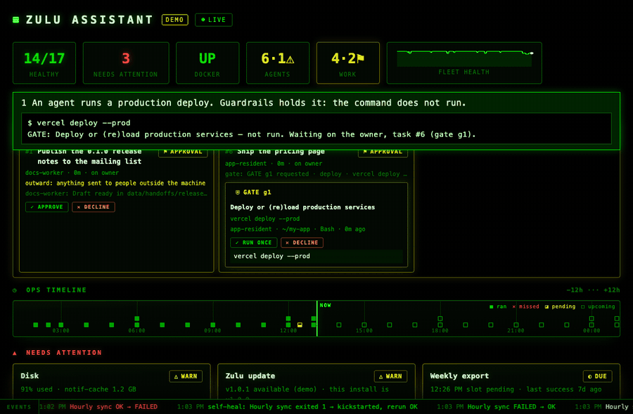
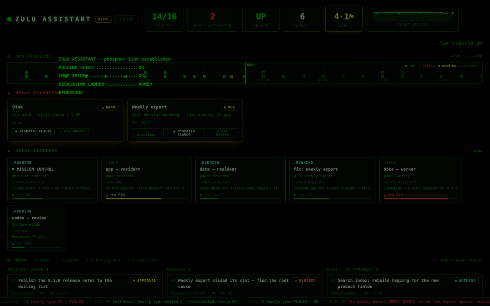
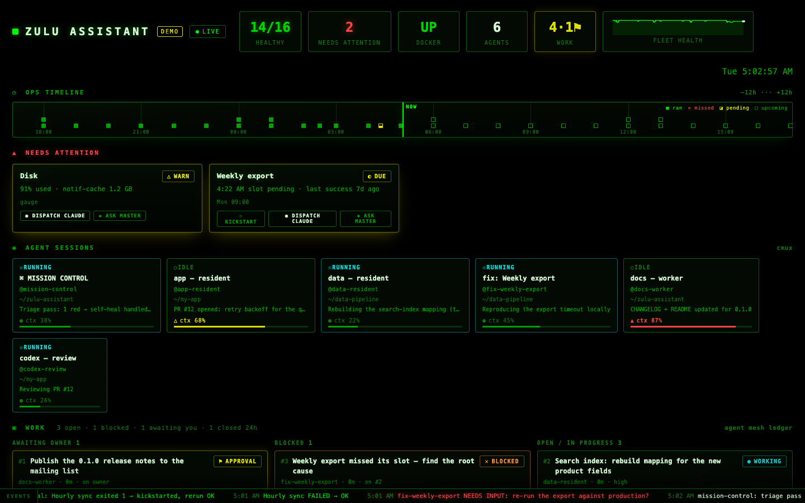
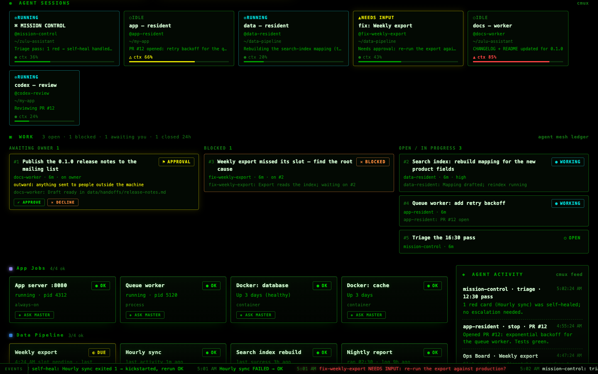
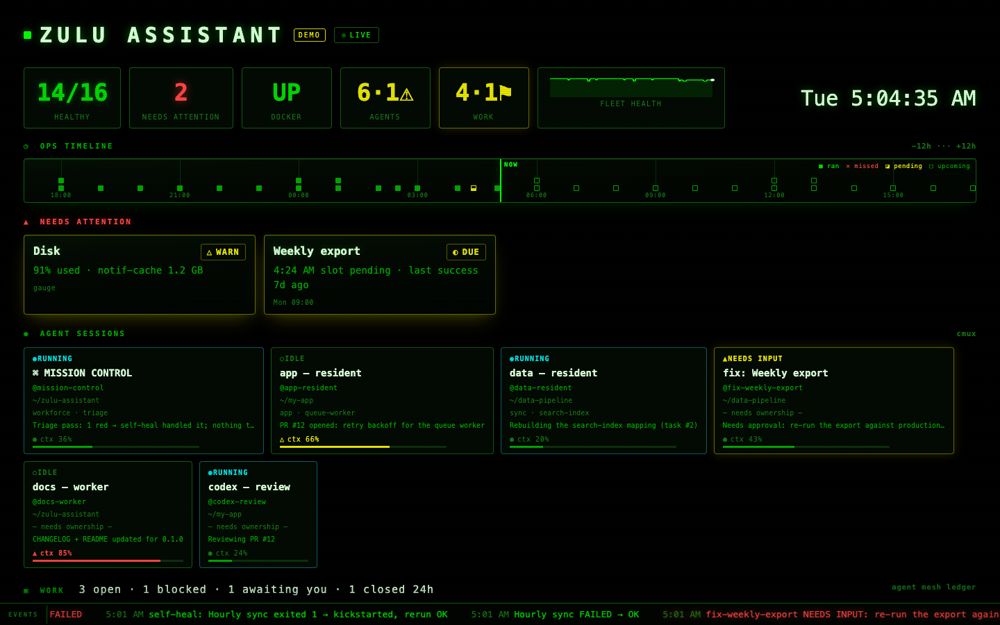
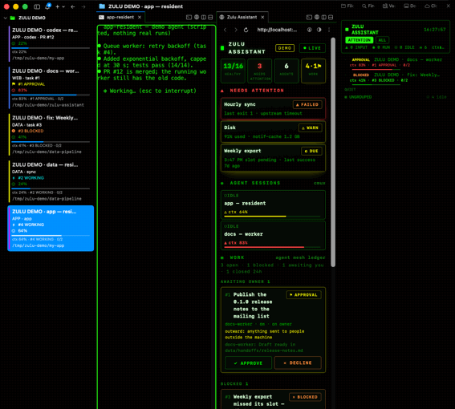
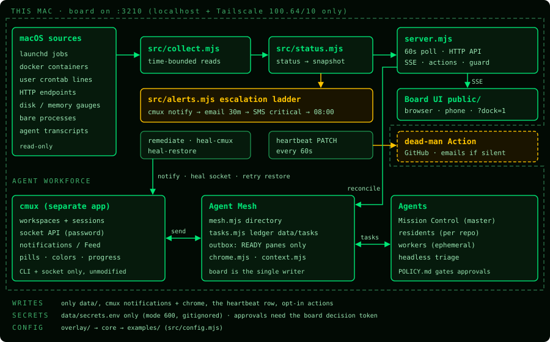

# Zulu Assistant

**A person approves before an agent merges, pushes, deploys or sends.**
When one of your Claude Code or Codex agents reaches something that can't be taken back, the command
doesn't run. It waits on your board with the exact command, folder and agent, and one click lets that
exact call run once, with a receipt on the task. Around the gate is a local ops board for the Mac that
runs your automations: it watches every LaunchAgent, container, cron line and endpoint, shows your live
agent sessions next to them, heals what it safely can and escalates the rest to you.

[](https://github.com/zulu-assistant/zulu-assistant/actions/workflows/ci.yml)
[](LICENSE)
[](https://github.com/zulu-assistant/zulu-assistant/stargazers)
  

Website: [https://zuluassistant.com](https://zuluassistant.com)

## Guardrails: a human gate and a receipt for every irreversible action



<sub>Recorded in demo mode (`./install.sh --demo`): a scripted agent, every name synthetic. The captions were added for the recording.</sub>

If Zulu is useful to you, a [star on GitHub](https://github.com/zulu-assistant/zulu-assistant) helps others find it.

Your agents work on their own, until they reach something that can't be taken back: a merge, a push to
`main`, a deploy, a script's `--commit` run, a message sent, a store write, a delete outside the
working tree. Then **the command doesn't run.** It waits for you on the board, showing the exact
command, folder and agent. The phone opens the same board page over your tailnet, and a push can ring
it; you decide with a click on that page. One approval lets that exact call run **once**,
and the task keeps a receipt of the attempt, your decision and the release (the agent reports how the
run went).

- **Enforced by the system, not the model's judgment:** a hook in every Claude Code and Codex session.
  It fails closed: board down means gated calls are denied.
- **Single-use approvals** bound to the exact command (or the tool's whole input). An approval can't be
  reused or stretched to a different command.
- **A program go**, when you want one: approve a task's plan once, and its routine merges and local
  service loads run without a tap. Each still leaves a receipt.
- **Honest limits:** it stops your agents' own mistakes, not a hostile program running as you. In a
  Codex session an approved call runs without Codex's own prompt only once the Codex hook entry is installed
  (`scripts/guardrails-install.sh --apply --codex`, since 1.3.2), and a held MCP tool call there can
  still meet that prompt. See [docs/GUARDRAILS.md](docs/GUARDRAILS.md)
  and [docs/SECURITY-MODEL.md](docs/SECURITY-MODEL.md).

Only want the gate? `./install.sh --guardrails` installs the board, the ledger and the hook, and nothing
else: [docs/QUICKSTART-GUARDRAILS.md](docs/QUICKSTART-GUARDRAILS.md).

## The board



<sub>Recorded in demo mode (`./install.sh --demo`). Every name in it is synthetic. A 38-second cut is in [docs/media/demo-short.gif](docs/media/demo-short.gif).</sub>

| Board | Agents + work ledger | `?tv` kiosk |
|---|---|---|
|  |  |  |

**Both halves together.** The board, and cmux with the phosphor sidebar. An agent asks for permission,
its row rises to the top of ATTENTION, and when it's answered the row drops back:



<sub>Recorded from `./install.sh --demo --cmux`: its own cmux window, six scripted fake agents, every name synthetic.</sub>

## The problem

- **Background jobs fail silently.** A LaunchAgent stops loading, a cron line
  disappears, a container goes unhealthy. You find out days later from the damage.
- **Agent sessions are invisible.** Six Claude Code sessions across six terminals:
  which one is waiting on you, which one is about to hit its context limit, which
  one died on reboot?
- **Agents can't coordinate safely.** They have no shared task list, no approval
  gate for risky steps, and no rule for when a human must decide.

## What you get

| | |
|---|---|
| **Ops Board** (`:3210`) | One card per launchd job, container, endpoint, cron line and process, plus disk and memory gauges. Schedules, logs and last-success come from the plists themselves. There is a 24h timeline, an event ticker, a `?tv` kiosk mode and a `/` palette. |
| **Agent tiles** | Every live Claude Code or Codex session in cmux is shown as RUNNING, IDLE or NEEDS INPUT, with its last message and a context-window gauge. |
| **Escalation ladder** | A cmux notification fires at once. Email follows after 30 red minutes, then an SMS webhook for the critical set, and an 08:00 digest each day. A dead-man's switch covers the board itself. |
| **Self-heal** | Covers a lost cmux socket password, sessions that fail to restore after a reboot, and disk pressure (using only the levers you bless). Each one leaves a ticker line. |
| **Mission Control** | A master agent in a pinned cmux workspace runs **residents** (one long-lived agent per repo) and **workers** (one per task). Your `POLICY.md` decides what they may do alone. |
| **Guardrails** | Irreversible agent actions wait for your approval and run once on it, with a receipt on the task. Policy in `policy.json`, rendered into `POLICY.md`. See [docs/GUARDRAILS.md](docs/GUARDRAILS.md). |
| **Agent Mesh** | A directory, a task ledger and a delivery rule. Agents hand work to each other as tasks and never type into a busy pane. Approvals happen on the board. |
| **Team chat intake** (optional) | Teammates who never open a terminal post requests in Slack. Each one becomes a ledger task routed through Mission Control, which picks the owner agent and holds every approval for you. Agents' questions come back in the thread, and a reply unblocks the task. Approvals, publishes and credentials never come from chat. Setup: [docs/INSTALL.md §3c](docs/INSTALL.md#3c-optional-team-chat-intake-slack). |
| **Brain** | Wires in three memories: an Obsidian vault (org memory), Graphify (code memory) and Claude memory files (agent memory). See [docs/BRAIN.md](docs/BRAIN.md). |

## Architecture



The server is a zero-dependency Node 22 process. Collectors run under time bounds every
60s, and a snapshot goes to the browser over SSE. Everything owner-specific (what to
watch, who the agents are, what needs approval) lives in `overlay/`. More in
[docs/ARCHITECTURE.md](docs/ARCHITECTURE.md).

## Quickstart

```bash
curl -fsSL https://zuluassistant.com/install | bash
```

Prefer GitHub directly? `curl -fsSL https://raw.githubusercontent.com/zulu-assistant/zulu-assistant/main/get.sh | bash` does the same.

That checks Node, copies the example config, starts the board as one LaunchAgent and opens it. It
installs nothing else: no Homebrew packages, nothing in your Claude settings, nothing that costs money.
The board shows your live Claude Code sessions straight away, read-only, and a **next steps** card with
the rest, each one command and each your choice: Guardrails (`./install.sh --guardrails`), everything
(`./install.sh --full`), the brain (`./install.sh --brain`), what to watch (`zulu setup --step watch`).

**Everything at once:** `curl -fsSL https://zuluassistant.com/install | bash -s -- --full` installs the
toolchain (it shows the list and asks once: Homebrew, Node 22, git, gh, uv, cmux, Claude Code, the
Codex CLI, Graphify and Obsidian; `ZULU_SKIP="codex obsidian graphify"` leaves items out), cmux config,
a scheduled triage job (it costs money: a headless model run four times a day), the brain and the agent
workforce, then starts **`zulu setup`**: connect GitHub, choose **Claude Code or
Codex** for Mission Control and for workers, pick what to watch from a scan of your Mac, add alert
channels, create your vault, grant the macOS permissions. Re-run any step later (`zulu setup
--step engines`); the board shows a setup card until you're done.

**Only want the gate?** `./install.sh --guardrails` from a clone installs the board, the ledger and the
hook, and nothing else: no cmux, no Homebrew packages, nothing paid. Five steps, about five minutes:
[docs/QUICKSTART-GUARDRAILS.md](docs/QUICKSTART-GUARDRAILS.md).

Just looking? `./install.sh --demo` from a clone runs a synthetic board on :3210 with Node 22 only;
`./install.sh --demo --cmux` adds a ZULU DEMO window in cmux with six fake agents, so you can see
both halves of the console working together.
Everything the setup does and cannot automate is in [docs/INSTALL.md](docs/INSTALL.md).

**Stuck, or did it just work?** Either way we'd like to hear. `./install.sh doctor` writes a redacted
diagnostic file (nothing is uploaded). Attach it to an
[install report](https://github.com/zulu-assistant/zulu-assistant/issues/new?template=install_report.yml).

If it caught something for you, a [star on GitHub](https://github.com/zulu-assistant/zulu-assistant) helps
others find it. Nothing in Zulu depends on it.

## Why not tmux and a dashboard?

tmux is great at keeping panes alive. It has no idea what an agent is doing. cmux
exposes agent lifecycle hooks, per-workspace status pills, a notification feed,
session restore with Claude auto-resume, and an authenticated socket API. The board and
the mesh are built on those. The honest trade-offs, and the cases where tmux is still
the better choice, are in [docs/WHY-NOT-TMUX.md](docs/WHY-NOT-TMUX.md).

## Safety model

- **Read-only by design.** The board never writes to anything it watches. It writes
  only its own `data/`, cmux notifications and chrome, the heartbeat row, and actions you click
  (KICKSTART, RESTART, START, DISPATCH, ASK MASTER). One exception keeps cmux reachable: when
  cmux loses its socket password, the board puts its own copy back into `~/.config/cmux/cmux.json`.
  Demo mode performs no actions at all.
- **Policy, not vibes.** `POLICY.md` belongs to you. Anything paid, outward-facing or
  destructive escalates to you, every time.
- **Approvals are yours.** Agents can *request* approval. Only you grant it, with a click on the
  board (from your phone too, over Tailscale) or from your own terminal, using a per-install
  decision token. Irreversible actions
  are **gated by the system** (Guardrails): they don't run until you approve that exact call, once.
- **Escalate, never guess.** Agents never auto-answer a trust dialog. They deliver
  messages only into a ready pane. Anything else is queued and reported.
- **Network.** The board serves localhost and your Tailscale range only. The LAN gets 403.
- **Clean by construction.** Every file is classified in `publish/manifest.json`, and a
  scrub gate plus gitleaks run in CI. See [SECURITY.md](SECURITY.md) and the full
  [security model](docs/SECURITY-MODEL.md).
- **Your state is yours.** `zulu backup` puts your ledger and config in one tarball (secrets only if
  you ask), and `zulu restore` checks it before changing anything.

## Requirements

| | Version |
|---|---|
| macOS | 26 (tested on 26.6, Apple silicon; older versions are untested) |
| Node | 22 (`nvm install 22` or `brew install node@22`) |
| [cmux](https://github.com/manaflow-ai/cmux) | 0.65.x, 0.64.x also works (quirks handled in code, see [docs/CMUX-SETUP.md](docs/CMUX-SETUP.md)). Needed for the agent half: session tiles, the mesh, Mission Control. The board's fleet monitoring runs without it. |
| Claude Code | ≥ 2.1.295 (tested 2.1.321) |
| gh | logged in (the dead-man's switch setup and the optional star prompt) |
| Optional to run | Codex CLI 0.162.x, Docker, Tailscale (phone access), Obsidian + Graphify (the brain). The full install (`--full`) installs the Codex CLI, Graphify and Obsidian unless you leave them out with `ZULU_SKIP`; the default one-line install installs none of them. |

Which model runs each role, and how to change it: [docs/MODELS.md](docs/MODELS.md). When something does not work: [docs/TROUBLESHOOTING.md](docs/TROUBLESHOOTING.md).

cmux is a separate GPL-licensed application. Install it yourself, unmodified. Zulu
Assistant only calls its CLI and socket and does not bundle or link it.

## Configuration

```
examples/          generic templates, shipped (the board runs on these until you add overlay/)
overlay/           YOUR config, gitignored: ./install.sh init copies examples/ here
  config/jobs.mjs    what to watch: JOBS, DOCKER_CONTAINERS, ENDPOINTS, CRON, PROCESSES, gauges, SETTINGS
  config/principals.json, channels.json   who may post requests from Slack, and where (optional)
  config/agents.json the mesh directory (maintained by the board)
  POLICY.md          what agents may do without you
  MISSION-CONTROL.md the master agent's contract
data/secrets.env   SMTP, SMS webhook, heartbeat, Slack tokens (template: secrets.env.example)
```

Config is resolved `overlay/` → core → `examples/`. Adding coverage takes one entry in
`overlay/config/jobs.mjs`. The board watches it on the next poll.

## Roadmap

- Latest release: **1.4.0** ([tested versions](docs/VERSIONS.md), [changelog](CHANGELOG.md)).
  It has the board, demo mode, Mission Control, the Agent Mesh, the brain templates, the installer,
  Slack team-chat intake and Guardrails; since 1.2: one-click upgrade, a Guardrails-only install,
  push notices to your phone (a self-hosted ntfy relay), GitHub intake, the evidence panel and the
  trust work (approvals only you can give, chained receipts, a gate that protects itself); and
  since 1.3: approvals bound to the commit and the script content they were given for, a light
  one-line install, a scheduled triage pass with two tools and a list of exact calls, and more that
  the gate reads (sessions an agent starts, MCP tools, runners), shipped observing.
- On `main`, for the next release: what is listed under Unreleased in the changelog.
- Later: Homebrew tap and an `npx` one-liner, a Linux/systemd collector, more chat transports
  (Discord, Teams, a web form), a hosted heartbeat relay so the dead-man's switch needs no database
  of your own.
- Ideas and votes: [Discussions](https://github.com/zulu-assistant/zulu-assistant/discussions).
  Good first issues are [labelled](https://github.com/zulu-assistant/zulu-assistant/labels/good%20first%20issue).

## Star history

[](https://star-history.com/#zulu-assistant/zulu-assistant&Date)

## About the star prompt

The installer asks once, and only in an interactive terminal with `gh` logged in:
`Star zulu-assistant on GitHub? [y/N]`. The full install (`--full`) asks as soon as your board first
answers (or at the end, if it didn't come up); the default install (`./install.sh`) and the demo ask
at the end. The default is No. Only an explicit `y` stars, using your own `gh` login. Where the
question cannot be asked (output to a pipe, or no `gh` login), the default install and the demo end
with one line instead that names this repository and says a star helps others find it. It is
printed once, and never after the question was asked. The board may also show
**one** toast, the first time it catches something for you (the first gate you approve, a session it
brought back, a task closed), with two buttons: **Star**, which just opens this page, and **Never ask
again**. Everything is kept in `data/star-prompt.json`, and nothing asks twice. No feature ever
depends on it. To star later, run `./install.sh star`.

## Contributing · Security · License

[CONTRIBUTING.md](CONTRIBUTING.md) · [SECURITY.md](SECURITY.md) ·
[CODE_OF_CONDUCT.md](CODE_OF_CONDUCT.md) · [CHANGELOG.md](CHANGELOG.md)

Commercial setup & support: [digitalnethosting.com](https://digitalnethosting.com)

MIT © Zulu Assistant contributors. cmux is a separate project under its own license.
