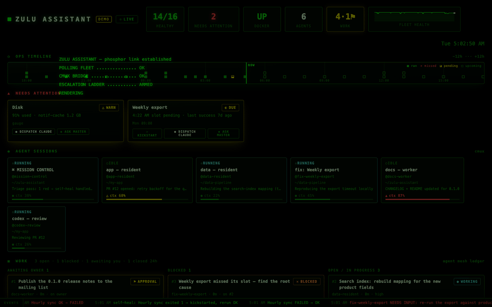
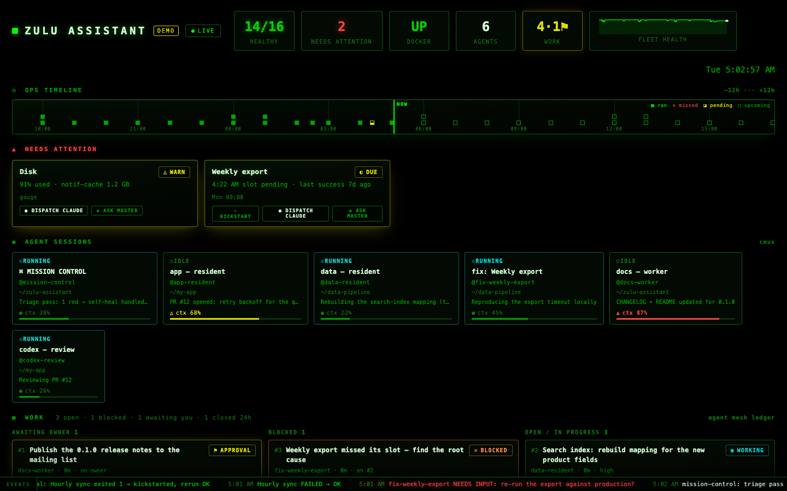
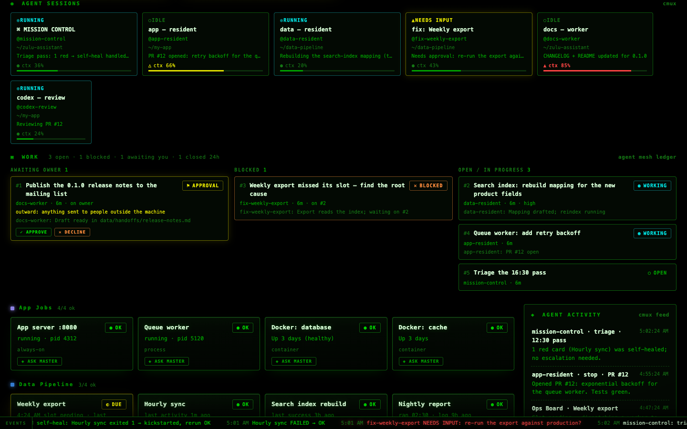
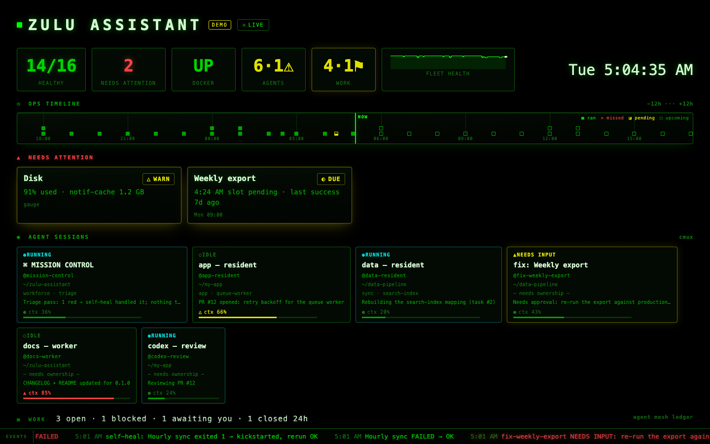
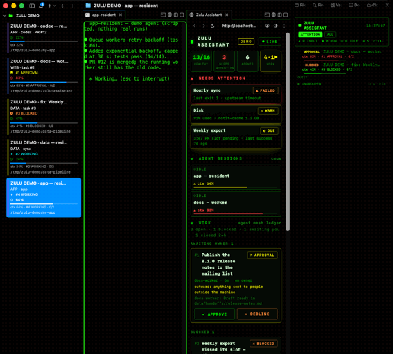
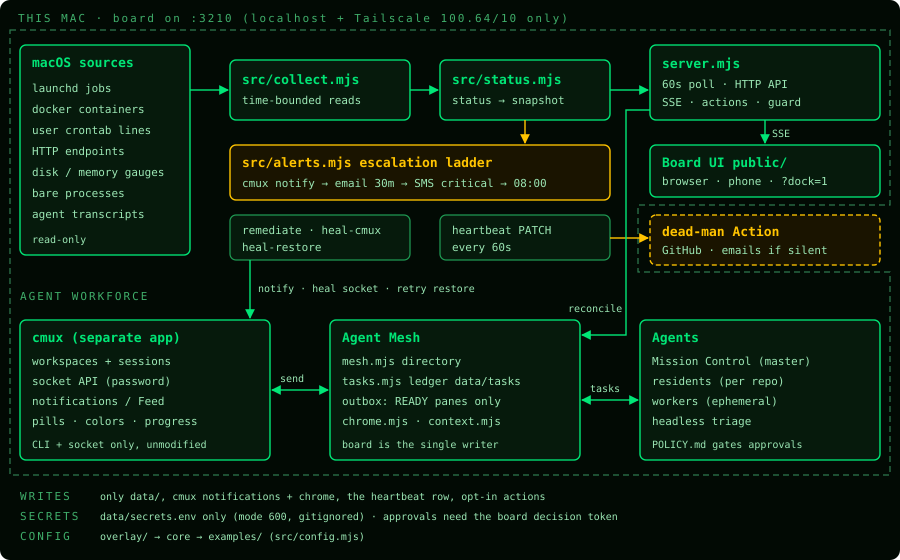

# Zulu Assistant

**A local ops board and agent workforce for the Mac that runs your automations.**
It watches every LaunchAgent, container, cron line and endpoint on the machine. It
shows your live Claude Code and Codex sessions next to them. When something breaks,
it heals what it safely can and escalates the rest to you.

[](https://github.com/zulu-assistant/zulu-assistant/actions/workflows/ci.yml)
[](LICENSE)
[](https://github.com/zulu-assistant/zulu-assistant/stargazers)
  

Website: [https://zuluassistant.com](https://zuluassistant.com)



<sub>Recorded in demo mode (`./install.sh --demo`). Every name in it is synthetic. A 38-second cut is in [docs/media/demo-short.gif](docs/media/demo-short.gif).</sub>

| Board | Agents + work ledger | `?tv` kiosk |
|---|---|---|
|  |  |  |

**Both halves together.** The board, and cmux with the phosphor sidebar. An agent asks for permission,
its row rises to the top of ATTENTION, and when it's answered the row drops back:



<sub>Recorded from `./install.sh --demo --cmux`: its own cmux window, six scripted fake agents, every name synthetic.</sub>

## The problem

- **Background jobs fail silently.** A LaunchAgent stops loading, a cron line
  disappears, a container goes unhealthy. You find out days later from the damage.
- **Agent sessions are invisible.** Six Claude Code sessions across six terminals:
  which one is waiting on you, which one is about to hit its context limit, which
  one died on reboot?
- **Agents can't coordinate safely.** They have no shared task list, no approval
  gate for risky steps, and no rule for when a human must decide.

## What you get

| | |
|---|---|
| **Ops Board** (`:3210`) | One card per launchd job, container, endpoint, cron line and process, plus disk and memory gauges. Schedules, logs and last-success come from the plists themselves. There is a 24h timeline, an event ticker, a `?tv` kiosk mode and a `/` palette. |
| **Agent tiles** | Every live Claude Code or Codex session in cmux is shown as RUNNING, IDLE or NEEDS INPUT, with its last message and a context-window gauge. |
| **Escalation ladder** | A cmux notification fires at once. Email follows after 30 red minutes, then an SMS webhook for the critical set, and an 08:00 digest each day. A dead-man's switch covers the board itself. |
| **Self-heal** | Covers a lost cmux socket password, sessions that fail to restore after a reboot, and disk pressure (using only the levers you bless). Each one leaves a ticker line. |
| **Mission Control** | A master agent in a pinned cmux workspace runs **residents** (one long-lived agent per repo) and **workers** (one per task). Your `POLICY.md` decides what they may do alone. |
| **Agent Mesh** | A directory, a task ledger and a delivery rule. Agents hand work to each other as tasks and never type into a busy pane. Approvals happen on the board. |
| **Team chat intake** (optional) | Teammates who never open a terminal post requests in Slack. Each one becomes a ledger task routed through Mission Control, which picks the owner agent and holds every approval for you. Agents' questions come back in the thread, and a reply unblocks the task. Approvals, publishes and credentials never come from chat. Setup: [docs/INSTALL.md §3c](docs/INSTALL.md#3c-optional-team-chat-intake-slack). |
| **Brain** | Wires in three memories: an Obsidian vault (org memory), Graphify (code memory) and Claude memory files (agent memory). See [docs/BRAIN.md](docs/BRAIN.md). |

## Architecture



The server is a zero-dependency Node 22 process. Collectors run under time bounds every
60s, and a snapshot goes to the browser over SSE. Everything owner-specific (what to
watch, who the agents are, what needs approval) lives in `overlay/`. More in
[docs/ARCHITECTURE.md](docs/ARCHITECTURE.md).

## Quickstart

```bash
curl -fsSL https://zuluassistant.com/install | bash
```

Prefer GitHub directly? `curl -fsSL https://raw.githubusercontent.com/zulu-assistant/zulu-assistant/main/get.sh | bash` does the same.

That installs the toolchain (it shows the list and asks once), the board, cmux config, the brain
and the agent workforce, then starts **`zulu setup`**: connect GitHub, choose **Claude Code or
Codex** for Mission Control and for workers, pick what to watch from a scan of your Mac, add alert
channels, create your vault, grant the macOS permissions. Re-run any step later (`zulu setup
--step engines`); the board shows a setup card until you're done.

Just looking? `./install.sh --demo` from a clone runs a synthetic board on :3210 with Node 22 only;
`./install.sh --demo --cmux` adds a ZULU DEMO window in cmux with six fake agents, so you can see
both halves of the console working together.
Everything the setup does and cannot automate is in [docs/INSTALL.md](docs/INSTALL.md).

**Stuck, or did it just work?** Either way we'd like to hear. `./install.sh doctor` writes a redacted
diagnostic file (nothing is uploaded). Attach it to an
[install report](https://github.com/zulu-assistant/zulu-assistant/issues/new?template=install_report.yml).

## Why not tmux and a dashboard?

tmux is great at keeping panes alive. It has no idea what an agent is doing. cmux
exposes agent lifecycle hooks, per-workspace status pills, a notification feed,
session restore with Claude auto-resume, and an authenticated socket API. The board and
the mesh are built on those. The honest trade-offs, and the cases where tmux is still
the better choice, are in [docs/WHY-NOT-TMUX.md](docs/WHY-NOT-TMUX.md).

## Safety model

- **Read-only by design.** The board never writes to anything it watches. It writes
  only its own `data/`, cmux notifications, the heartbeat row, and actions you click
  (KICKSTART, RESTART, START, DISPATCH, ASK MASTER). Demo mode performs no actions at
  all.
- **Policy, not vibes.** `POLICY.md` belongs to you. Anything paid, outward-facing or
  destructive escalates to you, every time.
- **Approvals on the board.** Agents can *request* approval. Only the board's WORK
  panel can grant it, using a per-install decision token.
- **Escalate, never guess.** Agents never auto-answer a trust dialog. They deliver
  messages only into a ready pane. Anything else is queued and reported.
- **Network.** The board serves localhost and your Tailscale range only. The LAN gets 403.
- **Clean by construction.** Every file is classified in `publish/manifest.json`, and a
  scrub gate plus gitleaks run in CI. See [SECURITY.md](SECURITY.md).

## Requirements

| | Version |
|---|---|
| macOS | 14 or later (launchd, zsh, BSD userland) |
| Node | 22 (`nvm install 22` or `brew install node@22`) |
| [cmux](https://github.com/manaflow-ai/cmux) | 0.65.x, 0.64.x also works (quirks handled in code, see [docs/CMUX-SETUP.md](docs/CMUX-SETUP.md)) |
| Claude Code | ≥ 2.1.280 (tested 2.1.296) · Codex CLI 0.162.x optional |
| gh | logged in (the dead-man's switch setup and the optional star prompt) |
| Optional | Codex CLI, Docker, Tailscale (phone access), Obsidian + Graphify (the brain) |

cmux is a separate GPL-licensed application. Install it yourself, unmodified. Zulu
Assistant only calls its CLI and socket and does not bundle or link it.

## Configuration

```
examples/          generic templates, shipped (the board runs on these until you add overlay/)
overlay/           YOUR config, gitignored: ./install.sh init copies examples/ here
  config/jobs.mjs    what to watch: JOBS, DOCKER_CONTAINERS, ENDPOINTS, CRON, PROCESSES, gauges, SETTINGS
  config/principals.json, channels.json   who may post requests from Slack, and where (optional)
  config/agents.json the mesh directory (maintained by the board)
  POLICY.md          what agents may do without you
  MISSION-CONTROL.md the master agent's contract
data/secrets.env   SMTP, SMS webhook, heartbeat, Slack tokens (template: secrets.env.example)
```

Config is resolved `overlay/` → core → `examples/`. Adding coverage takes one entry in
`overlay/config/jobs.mjs`. The board watches it on the next poll.

## Roadmap

- v0.1: the board, demo mode, Mission Control, Agent Mesh, the brain templates, the installer,
  and (beta.3) Slack team-chat intake.
- Next: Homebrew tap and an `npx` one-liner, a Linux/systemd collector, a pluggable
  notifier interface (ntfy, chat alerts), more chat transports (Discord, Teams, a web form), a hosted heartbeat relay so the dead-man's switch
  needs no database of your own.
- Ideas and votes: [Discussions](https://github.com/zulu-assistant/zulu-assistant/discussions).
  Good first issues are [labelled](https://github.com/zulu-assistant/zulu-assistant/labels/good%20first%20issue).

## Star history

[](https://star-history.com/#zulu-assistant/zulu-assistant&Date)

## About the star prompt

The installer asks once, and only in an interactive terminal, as soon as your board first
answers (or at the end, if it didn't come up): `Star zulu-assistant on GitHub? [y/N]`. The default is No. If `gh` is not logged in, it skips the question
silently. Only an explicit `y` stars, using your own `gh` login. The board may also show
**one** toast, the first time it catches something for you, with two buttons:
**Star**, which just opens this page, and **Never ask again**. Both answers are kept in
`data/star-prompt.json`, and neither asks again. No feature ever depends on it. To star
later, run `./install.sh star`.

## Contributing · Security · License

[CONTRIBUTING.md](CONTRIBUTING.md) · [SECURITY.md](SECURITY.md) ·
[CODE_OF_CONDUCT.md](CODE_OF_CONDUCT.md) · [CHANGELOG.md](CHANGELOG.md)

Commercial setup & support: [digitalnethosting.com](https://digitalnethosting.com)

MIT © Zulu Assistant contributors. cmux is a separate project under its own license.
