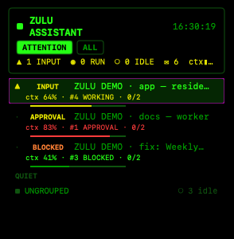

# Install Zulu Assistant

This runbook takes a logged-in macOS account to a running Zulu Assistant:

- **the Ops Board** on `http://localhost:3210` — status of your LaunchAgents, Docker containers,
  endpoints, crontab jobs, disk, memory and live agent sessions;
- **cmux**, the agent terminal the board drives (see [CMUX-SETUP.md](CMUX-SETUP.md));
- **Mission Control** and the **Agent Mesh** (see `MISSION-CONTROL.md`, `AGENT-MESH.md`);
- optionally **the brain**: an Obsidian vault, Graphify and Claude memory (see [BRAIN.md](BRAIN.md)).

One command does the scriptable work, then a guided setup collects what only you can provide:

```bash
curl -fsSL https://zuluassistant.com/install | bash
```

Alternative, straight from GitHub: `curl -fsSL https://raw.githubusercontent.com/zulu-assistant/zulu-assistant/main/get.sh | bash`.

```
get.sh → clone → install.sh: toolchain (asks once) → overlay/ → agent OS → brain → zulu setup
zulu setup: GitHub → engines (Claude / Codex) → you + policy → what to watch → alerts
            → vault → Graphify + memory → macOS permissions → residents → verify + Mission Control
```

Already cloned? `./install.sh` from the checkout does the same. This document explains each piece
and what the setup cannot automate.

## 1. Prerequisites

| Tool | Pin | Why | Install |
|---|---|---|---|
| macOS | 26.x (Darwin 25) | launchd and TCC behaviour described here | — |
| Homebrew | any | installs cmux, gh, uv | https://brew.sh |
| Node | **22** (nvm recommended) | zero-dependency server; launchd has no shell profile, so `scripts/env.sh` resolves Node itself (nvm pin → newest nvm → Homebrew) | `nvm install 22` |
| Claude Code | **≥ 2.1.280** (tested 2.1.296) | current model IDs need it; the mesh's readiness kick works around a 2.1.280 unsubmitted-prompt bug | `npm i -g @anthropic-ai/claude-code` |
| cmux | **0.65.x** (0.64.x also works) | the code works around specific cmux quirks (see CMUX-SETUP.md) | `brew install --cask cmux` |
| gh | any, logged in | clone, PRs, Actions secrets for the dead-man switch | `brew install gh` |
| Codex CLI | optional, tested 0.162.1 | Codex as Mission Control / worker engine, Codex panes | `npm i -g @openai/codex` |
| uv + Graphify | optional, `graphifyy==0.9.83` | code memory (BRAIN.md) | `brew install uv` |
| Tailscale | optional | phone access to the board | App Store build |

Pin overrides go in `data/local.env` (gitignored), e.g. `MC_NODE_VERSION=v22.x.y` or `MC_PORT=3211`.

## 2. Try it first: demo mode

```bash
git clone https://github.com/zulu-assistant/zulu-assistant.git ~/zulu-assistant
cd ~/zulu-assistant
./install.sh --demo        # board on http://localhost:3210 with synthetic jobs, agents and tasks
./install.sh demo-stop     # stop it
```

Demo mode (`MC_DEMO=1`) needs only Node 22. It installs no LaunchAgents, needs no cmux and
touches nothing outside the checkout. Use it to see the board before committing to a full install.

### The cmux half too: `--demo --cmux`

```bash
./install.sh --demo --cmux # the board, plus a "ZULU DEMO" window in cmux with six fake agents
./install.sh demo-stop     # stops the board and closes the ZULU DEMO window
```

With cmux running, this opens a **separate cmux window** called ZULU DEMO, holding a ZULU DEMO
workspace group of six fake agent panes (`scripts/demo-agent.mjs`, scripted transcripts, no model
calls). One works and then asks for permission, one streams work while its context gauge climbs
into amber, one is blocked, one is a Codex pane, two are quiet. The demo board reads those panes
and writes the same sidebar chrome the real board writes: domain colors, task and `ctx` pills, and
the progress label that puts **▲ INPUT** at the top of the phosphor sidebar's ATTENTION list. Press
`1` in the asking pane and its row drops back down; left alone it answers itself after ~25 s and
loops.



The demo never changes which sidebar is showing (that stays your choice). It prints the one line
that turns the phosphor sidebar on for the demo window only:
`cmux right-sidebar set custom phosphor --window <id> --no-focus`. No cmux? The board-only demo
still runs. What it writes and how it cleans up: [CMUX-SETUP.md](CMUX-SETUP.md#the-cmux-demo).

## 3. Full install

```bash
./install.sh
```

In order, it:

1. **Installs the toolchain** (`scripts/prereqs.sh`): it lists what is missing — Homebrew, Node 22,
   git/gh/uv, cmux, the Claude Code and Codex CLIs, Graphify, Obsidian — asks once, then installs
   only those. `ZULU_SKIP="obsidian codex"` leaves items out; `--yes` skips the question.
2. **Runs `init`**: copies `examples/` → `overlay/`, never overwriting a file that exists.
3. **Runs `scripts/bootstrap.sh install`** (below).
4. **Offers `zulu setup`** — the guided part (next section). The board shows a *Zulu setup* card
   until it is done; `zulu setup --status` prints the checklist any time.
5. **Asks once** whether to star the GitHub repo. The default is No; the answer is remembered.
   `./install.sh star` (or `bin/zulu star`) does it later.

Other entry points:

| Command | What it does |
|---|---|
| `./install.sh init` | only the `examples/` → `overlay/` copy (never overwrites) |
| `./install.sh check` | `scripts/bootstrap.sh check`: PASS/WARN/FAIL table, read-only, exit 1 on any FAIL |
| `./install.sh verify` | `scripts/bootstrap.sh verify`: end-to-end checks (§6) |
| `./install.sh --brain` | skills, hook guards and the Graphify install line (BRAIN.md) |
| `./install.sh mission-control` | opens the Mission Control workspace in cmux (`scripts/mission-control.sh`) |
| `./install.sh --demo [--cmux]` / `demo-stop` | the demo board, optionally with the ZULU DEMO cmux window (§2) |

`scripts/bootstrap.sh install` also takes `--dry-run` (print the plan), `--force` (replace a
differing file; it backs up first as `<file>.bak-<ts>`) and `--deadman` (§5). Every step prints
`done`, `skip`, `would` or `kept`, and re-running it is safe.

What `bootstrap.sh install` does:

1. Creates `data/`, `logs/`, `~/.config/cmux`, `~/.config/ghostty` and the selfheal marker dir.
2. Generates `data/cmux-socket-password` (mode 600) once. It is never regenerated, because cmux
   and every script share it.
3. Writes `~/.config/ghostty/config` (theme, font, colours that cmux reads).
4. Renders `~/.config/cmux/cmux.json` from `system/cmux/cmux.json.tmpl` with the password injected.
5. Renders and loads the LaunchAgents in `system/launchd/*.plist.tmpl`: the board
   (`<prefix>.master-console`, KeepAlive) and scheduled triage (`<prefix>.mission-control-triage`).
   The label prefix comes from `overlay/config/zulu.env` (`MC_LABEL_PREFIX`, default
   `com.zulu-assistant`).
6. Installs cmux Tier 1 (Dock seed + phosphor sidebar) with `scripts/cmux-tier1-install.mjs`.
7. Applies cmux pane chrome. This needs a running cmux, so it is skipped until §4 is done.
8. Seeds the agent directory `overlay/config/agents.json` (empty; the board registers live workspaces).

### Your configuration

Everything owner-specific lives in `overlay/` (gitignored):

| File | Holds |
|---|---|
| `overlay/config/jobs.mjs` | the registry: one entry per watched LaunchAgent, container, endpoint, process or cron job |
| `overlay/config/agents.json` | the Agent Mesh directory (maintained by the board) |
| `overlay/config/mesh.json` | mesh switches (`autoRename`, `chrome`, domain colours) |
| `overlay/config/models.json` | Mission Control / worker model IDs |
| `overlay/config/TRIAGE.md` | the scheduled triage procedure |
| `overlay/config/zulu.env` | `MC_LABEL_PREFIX`, `VAULT` |
| `overlay/POLICY.md` | what agents may approve alone and what always escalates to you |
| `overlay/MISSION-CONTROL.md` | the Mission Control contract |

`src/config.mjs` resolves `overlay/<file>` → `<file>` → `examples/<file>`, so a missing overlay
file falls back to the generic example. After editing the registry:

```bash
launchctl kickstart -k gui/$(id -u)/com.zulu-assistant.master-console
```

## 3b. zulu setup — your accounts and config

Resumable and re-runnable; every step has a live check, so finished steps are ticked without asking.
Logins always go through each tool's own flow (`gh auth login`, `claude auth login`, `codex login`) —
Zulu never stores a credential. Redo one step with `zulu setup --step <id>`.

| Step | What it does |
|---|---|
| `github` | `gh auth login` (dead-man's switch, repo work, updates) |
| `engines` | pick **Claude Code or Codex** for Mission Control, for workers/residents and for the scheduled triage; logs in to each |
| `owner` | your name as the approver; fills `overlay/POLICY.md`, `MISSION-CONTROL.md`, `TRIAGE.md` |
| `watch` | scans this Mac (LaunchAgents, Docker, crontab) + endpoints you type; you tick what to watch → `overlay/config/local.json` |
| `alerts` | optional email (SMTP), SMS webhook, dead-man heartbeat → `data/secrets.env` (600) |
| `vault` | creates (or adopts) your Obsidian vault from `examples/vault/`, git-inits it, optional private backup repo, loads its backup + staleness agents |
| `brain` | skills + Graphify hooks + MCP for Claude (and `~/.codex/AGENTS.md` + MCP for Codex) |
| `macos` | opens the exact Settings panes (Full Disk Access, Login Items, auto-login), `pmset autorestart` |
| `residents` | pick repos to give a long-lived resident agent |
| `verify` | `zulu check`, board answer, start Mission Control on your chosen engine |

Problems? `zulu doctor` writes a redacted diagnostic file to `data/` (never uploaded) for an issue.

## 4. Manual steps

No script can do these. Do them early; some need an app relaunch.

1. **Full Disk Access for cmux.** System Settings → Privacy & Security → Full Disk Access → + →
   `/Applications/cmux.app` → on → quit and relaunch cmux. Without it, agents in cmux panes are
   blind to TCC-protected paths and reads fail silently. Proof: `./install.sh check` run *from a
   cmux pane* shows `PASS full disk access` (from another terminal it probes that terminal).
2. **cmux as a login item.** System Settings → General → Login Items → + → cmux, or:
   ```bash
   osascript -e 'tell application "System Events" to make login item at end with properties {path:"/Applications/cmux.app", hidden:false}'
   ```
3. **Logins**: `gh auth login`; `claude`, then `/login`; `codex login` if you use Codex.
4. **First cmux launch**: `open -a cmux`, then run `./install.sh` again. With the socket up it applies
   pane chrome and validates the sidebar. Choosing the Dock or the phosphor sidebar is your click;
   agents never switch them.
5. **Power chain (optional, recommended for an always-on Mac)**:
   - `sudo pmset autorestart 1` — power back on after a power cut;
   - System Settings → Users & Groups → automatically log in as your user.

   With the cmux login item and the KeepAlive LaunchAgents, this brings the fleet back unattended:
   power on → login → cmux restores workspaces and resumes Claude → the board starts → the
   selfheal runner catches up missed slots → the board re-injects the cmux socket password and
   retries failed session restores.
6. **Tailscale (optional, phone access).** Install the App Store build and log in on both devices,
   then open `http://<tailscale-ip>:3210` on the phone (e.g. `http://100.101.102.103:3210`;
   `tailscale ip -4` prints yours). The server admits only localhost and the Tailscale CGNAT range
   (100.64.0.0/10); other LAN clients get 403. Don't use `tailscale serve` with the App Store build.

## 5. Secrets

All credentials live in **one file, `data/secrets.env`** (gitignored, mode 600). Start from the
template and fill only what you want:

```bash
cp secrets.env.example data/secrets.env && chmod 600 data/secrets.env
```

| Keys | Turns on |
|---|---|
| `SMTP_HOST/PORT/USER/PASS`, `ALERT_EMAIL_TO` | alert email after 30 red minutes, plus the 08:00 fleet briefing |
| `SMS_WEBHOOK_URL/KEY`, `SMS_ALERT_TO` | critical-tier SMS through your own webhook |
| `HEARTBEAT_URL/KEY[/HOST]` | the dead-man heartbeat PATCH every 60 s |
| `HEARTBEAT_READ_URL/KEY` | only for `bootstrap.sh install --deadman` (the workflow's read side) |

A missing key switches that tier off; nothing else breaks. The file is re-read on change, so no
restart is needed. `./install.sh check` names every empty key and the tier it disables.

**Dead-man's switch** (the cloud side that survives the Mac): the board PATCHes a heartbeat row;
a GitHub Actions workflow emails you if it goes quiet. To enable it, rename
`.github/workflows/deadman.example.yml` to `deadman.yml` in a repo of yours and uncomment its
schedule, push its Actions secrets with `scripts/bootstrap.sh install --deadman` (values are never
printed), then test with `gh workflow run deadman.yml`.

## 6. Verify

```bash
./install.sh verify
```

Expected shape:

```
PASS  tests                      N pass
PASS  board                      HTTP 200 · N cards, N sessions
PASS  cmux notify                sent (check the cmux Feed)
PASS  heal-restore dry run
PASS  triage selfheal (dry)      DRY[mission-control-triage]: WOULD RUN …
PASS  no hard-coded paths        scripts/ system/
0 fail, 0 warn
```

On a fresh Mac most job cards read DOWN or missing until you register your own jobs in
`overlay/config/jobs.mjs`. That is expected. Then check by hand:

- the board loads at `http://localhost:3210` (and on the phone, if you set up Tailscale);
- **◉ DISPATCH CLAUDE** on a red card opens a new cmux workspace;
- the dead-man workflow is green.

Then start Mission Control: `./install.sh mission-control`.

## 7. Rollback

| What | Undo |
|---|---|
| A LaunchAgent | `launchctl bootout gui/$(id -u)/<label>` and remove `~/Library/LaunchAgents/<label>.plist` |
| Dock + phosphor sidebar files | `node scripts/cmux-tier1-install.mjs --revert` |
| cmux pane chrome | `node scripts/cmux-chrome-config.mjs --revert ~/.config/cmux/cmux.json.bak-<ts>` |
| Workspace colours / descriptions | set `"chrome": false` in `overlay/config/mesh.json`, then `cmux workspace-action --workspace <id> --action clear-color` (or `clear-description`) |
| Any file `--force` replaced | the `<file>.bak-<ts>` next to it |
| Board code | `git revert <sha>`, then `launchctl kickstart -k gui/$(id -u)/<prefix>.master-console` |

## 8. Never do

- **Never delete selfheal markers — they are state, not cache.** Protect
  `~/Library/Application Support/selfheal-runner/`, the legacy `~/.cache/selfheal-runner/`, and
  `~/Library/Logs/selfheal-runner.log`. Deleting the markers makes every scheduled job look like it
  never ran, so every job fires a catch-up at once — including paid or outbound ones. Avoid GUI
  "cleaner" apps that empty `~/.cache`. After a wipe, restore from the vault's
  `.scripts/state-mirror/` (BRAIN.md); never fabricate markers.
- **Don't switch cmux `automation.socketControlMode` away from `"password"`.** In
  `"notifications"` mode, dispatch and every workspace call from the board break.
- Don't commit `data/` (secrets, ledger, socket password), `overlay/` or `graphify-out/`.
- Don't let agents switch the cmux sidebar or Dock, rename or close workspaces, or create
  workspace groups (groups hide their anchor workspace). Those are your calls.
- Don't bind another service to the board's port (3210 by default; override with `MC_PORT`).
